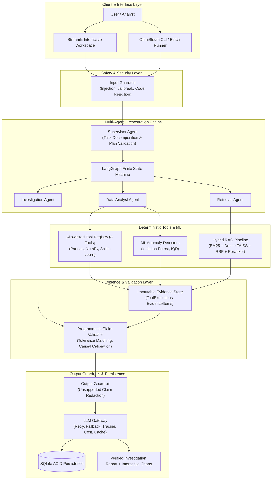
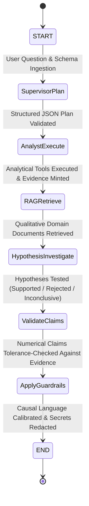
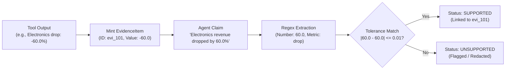
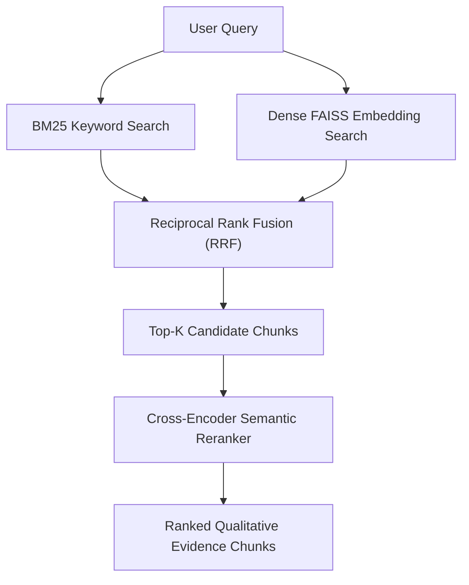
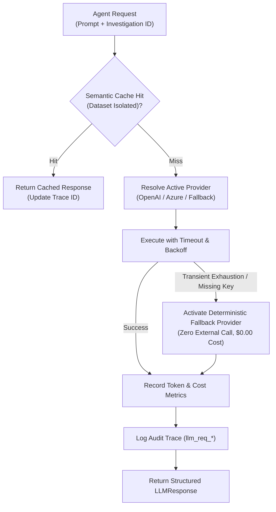
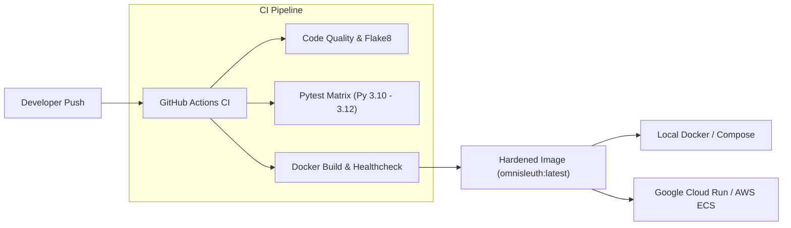

# OmniSleuth 🔍

**An Evidence-Grounded Multi-Agent Data Investigation System**

OmniSleuth is a bounded, production-inspired AI/ML data investigation system designed to analyze structured business and operational datasets (e.g., sales, revenue, orders, inventory). Rather than acting like a naive conversational chatbot that hallucinates calculations and asserts unsubstantiated causal claims, OmniSleuth enforces **deterministic Python execution**, **allowlisted analytical tools**, **programmatic evidence provenance**, **hybrid contextual retrieval (RAG)**, **finite state machine orchestration**, **dual-layer guardrails**, and a **production-grade LLM Gateway with deterministic offline fallback**.

The entire system is **100% offline-first reproducible**, executing comprehensive unit, integration, and security tests (552 passed in the Phase E verification run), ML detectors, hybrid retrieval pipelines, and empirical evaluations without external network access or paid API keys.

---

## Documentation Quick Links

- 🏛️ **[System Architecture & Component Design](docs/ARCHITECTURE.md)**: End-to-end architecture, 6-tab UI workspace, deterministic execution engine, and Mermaid workflow diagrams.
- ⚙️ **[Setup & Operations Guide](docs/OPERATIONS.md)**: Local installation, running tests, dataset loading/uploading, backup/restore procedures, and troubleshooting.
- 🛡️ **[Security Architecture & Deployment Boundaries](docs/SECURITY.md)**: Upload validation, Excel defenses, session isolation, and production reverse proxy requirements.
- 🎯 **[Technical Interview & Viva Defense Guide](docs/INTERVIEW_GUIDE.md)**: Detailed answers to 10 core technical interview questions with honest trade-offs.
- 📋 **[Project Presentation & Executive Summary](docs/PROJECT_SUMMARY.md)**: Resume description, 90-second elevator pitch, implemented vs. future feature matrix, and live demo script.

---

## Table of Contents

1. [Problem Statement & Motivation](#problem-statement--motivation)
2. [Core Design Principles & Formal Guarantees](#core-design-principles--formal-guarantees)
3. [System Architecture](#system-architecture)
4. [End-to-End Investigation Workflow](#end-to-end-investigation-workflow)
5. [Key Subsystems & Methodologies](#key-subsystems--methodologies)
   - [Deterministic Analytics Engine & Allowlisted Tools](#1-deterministic-analytics-engine--allowlisted-tools)
   - [Machine Learning Anomaly Detection](#2-machine-learning-anomaly-detection)
   - [Evidence Provenance & Programmatic Claim Validation](#3-evidence-provenance--programmatic-claim-validation)
   - [Hybrid Retrieval-Augmented Generation (RAG)](#4-hybrid-retrieval-augmented-generation-rag)
   - [Multi-Agent Coordination & Finite State Graph](#5-multi-agent-coordination--finite-state-graph)
   - [Multi-Layer System Guardrails](#6-multi-layer-system-guardrails)
   - [Production LLM Gateway & Offline Fallback](#7-production-llm-gateway--offline-fallback)
   - [ACID Persistence Layer](#8-acid-persistence-layer)
6. [Empirical Evaluation & Benchmark Results](#empirical-evaluation--benchmark-results)
7. [Installation & Getting Started](#installation--getting-started)
8. [Deployment & Containerization](#deployment--containerization)
9. [Project Directory Structure](#project-directory-structure)
10. [Limitations & Ethical Considerations](#limitations--ethical-considerations)
11. [Academic Project & Viva Defense Guide](#academic-project--viva-defense-guide)

---

## Problem Statement & Motivation

### The Challenge with LLMs in Business Intelligence
Generative Large Language Models (LLMs) applied directly to structured business data suffer from three critical flaws:
1. **Mathematical Hallucination**: LLMs are autoregressive probability models, not arithmetic engines. Direct LLM calculations on large tabular datasets produce frequent rounding errors, fabricated percentages, and false aggregates.
2. **Unsupported Causal Speculation**: Standard chatbots conflate correlation with causation, asserting that a revenue drop was "caused by" a single factor without empirical justification or hypothesis testing.
3. **Security & Code Execution Risks**: Naive systems allowing LLMs to generate and execute arbitrary Python code (`exec()`/`eval()`) introduce critical Remote Code Execution (RCE) vulnerabilities, syntax failures, and non-deterministic behavior.

### The OmniSleuth Solution
OmniSleuth solves these challenges by treating the LLM as a **planner and natural language synthesizer**, while delegating all computational, statistical, and document retrieval tasks to **strictly typed, deterministic Python tools**. Every factual claim is programmatically validated against an immutable evidence store before being presented to the user.



---

## Core Design Principles & Formal Guarantees

OmniSleuth is built on seven core architectural rules:

1. **Rule 1: Deterministic Calculations**: The LLM *never* computes numbers. All aggregations, trends, deltas, percentage contributions, and metric decompositions are executed strictly by Pandas, NumPy, and scikit-learn.
2. **Rule 2: Allowlisted Tools Only**: All tool interactions are mediated through typed Pydantic input/output schemas with runtime validation and execution logging. Arbitrary code generation (`exec`/`eval`) is rejected.
3. **Rule 3: Qualitative Contextual RAG**: Document retrieval provides operational business context, data dictionaries, and domain definitions—never numerical calculation.
4. **Rule 4: Evidence Provenance**: Every factual or numerical claim references a unique, immutable evidence identifier (`evi_*`, `tool_exec_*`, `doc_*`).
5. **Rule 5: Programmatic Claim Validation**: A dedicated validator extracts numerical entities and validates them within a configured tolerance against the `EvidenceStore`. Unsupported numbers are flagged as `UNSUPPORTED`.
6. **Rule 6: Calibrated Causal Phrasing**: Observational data cannot prove definite causality. The system automatically detects and rewrites speculative causal claims (e.g., "caused by") into calibrated observational language (e.g., "associated with", "contributed to").
7. **Rule 7: Bounded Agentic Execution**: Finite state machines enforce strict limits: Maximum Investigation Depth $\le 3$, Maximum Tool Calls $\le 10$, Maximum Retries $\le 2$, with graceful termination under insufficient evidence.

---

## System Architecture

### Major Module Breakdown

```text
omnisleuth/
├── core/             # Configuration (pydantic-settings), structured logging, exception hierarchy
├── ingestion/        # CSV/Excel loading, encoding detection, SHA-256 dataset hashing, type inference
├── profiling/        # Statistical profiling, data quality scorecard, automated data dictionary
├── analytics/        # Deterministic computation engine (aggregations, trends, contributions, decomposition)
├── ml/               # Anomaly detection (IQR baseline, Isolation Forest, synthetic evaluation)
├── tools/            # 8 strictly allowlisted Pydantic tools with execution logging and audit tracking
├── evidence/         # Immutable EvidenceItem store, ClaimValidator, causal phrase calibration
├── rag/              # Hybrid RAG: BM25, Dense FAISS, Reciprocal Rank Fusion (RRF), Cross-Encoder Reranker
├── agents/           # Multi-agent roles: Supervisor, Data Analyst, Retrieval Agent, Investigator
├── discovery/        # Autonomous multi-dimensional auto-scanner and investigation tree explorer
├── workflow/         # LangGraph 7-step compiled state graph with bounded execution constraints
├── guardrails/       # Dual-layer guardrails (Prompt injection, jailbreak, off-topic, secret redaction)
├── llm/              # LLM Gateway: provider abstraction (OpenAI, Azure, Fallback), retries, cache, tracing
├── persistence/      # SQLite repository pattern with JSON serialization and ACID audit history
└── ui/               # Streamlit multi-tab analytical workspace (Overview, Profile, Investigate, Tree, Evaluation)
```

---

## End-to-End Investigation Workflow

The core investigation pipeline operates as a deterministic finite state machine implemented via LangGraph:



### State Machine Execution Steps
1. **Supervisor Plan**: Decomposes the user query into sub-goals, identifies required metrics and dimensions, and validates tool availability within bounded limits.
2. **Analyst Execute**: Invokes allowlisted analytical tools (`aggregate_metric`, `calculate_trend`, `compare_segments`, `detect_anomalies`), writing raw outputs to the `EvidenceStore`.
3. **RAG Retrieve**: Searches operational logs and business policy documents using hybrid dense + sparse retrieval.
4. **Hypothesis Investigate**: Generates competing hypotheses for anomalies or trends, systematically gathering evidence to mark each hypothesis as `SUPPORTED`, `REJECTED`, or `INCONCLUSIVE`.
5. **Validate Claims**: Scans synthesized natural language claims, extracts numbers via regex, and verifies them against registered `EvidenceItem` values.
6. **Apply Guardrails**: Checks for secret leakage, prompt injection bypasses, unsupported claims, and converts causal language to calibrated observational terms.

---

## Key Subsystems & Methodologies

### 1. Deterministic Analytics Engine & Allowlisted Tools
OmniSleuth exposes exactly 8 allowlisted tools, strictly governed by Pydantic schemas:
- `profile_dataset`: Returns row counts, column types, completeness, and quality warnings.
- `aggregate_metric`: Computes exact sums, means, medians, standard deviations, and record counts grouped by dimensions.
- `calculate_trend`: Aggregates metrics across time periods (monthly, weekly) and computes percentage growth deltas.
- `compare_segments`: Compares metric distributions between categorical segments (e.g., North vs. South region).
- `segment_contribution`: Computes each segment's exact percentage contribution to total period-over-period decline or growth.
- `decompose_metric`: Mathematically decomposes revenue shifts into volume ($\Delta \text{Orders} \times \text{AOV}_0$) and price ($\Delta \text{AOV} \times \text{Orders}_1$) components.
- `detect_anomalies`: Runs multivariate Isolation Forest or IQR outlier detectors on designated numerical columns.
- `create_chart`: Emits verified Plotly JSON figures for trendlines, segment bars, and scatter plots.

### 2. Machine Learning Anomaly Detection
- **Isolation Forest**: Subsamples data into isolation trees ($O(n \log n)$ time complexity) to detect non-linear, multi-dimensional anomalies across revenue, units, and order volume.
- **IQR Baseline**: Non-parametric univariate outlier thresholding ($Q_1 - 1.5 \times \text{IQR}$, $Q_3 + 1.5 \times \text{IQR}$) for rapid distribution checks.
- **Synthetic Ground-Truth Verification**: Evaluated on datasets with planted anomalies, achieving **$F_1 = 0.902$** (Precision: 88.46%, Recall: 92.00%).

### 3. Evidence Provenance & Programmatic Claim Validation
Every tool execution generates an immutable `EvidenceItem` containing:
- `evidence_id`: Unique traceable hash (e.g., `evi_20261007_a1b2c3d4`).
- `source_tool`: The tool producing the record.
- `dataset_version`: SHA-256 hash of the dataset.
- `raw_data`: Typed output values, aggregates, and statistical scores.

The `ClaimValidator` extracts every number in synthesized text, compares it against the `raw_data` of associated evidence items within a strict relative tolerance ($\pm 1.0\%$), and flags any discrepancy as `UNSUPPORTED`.



### 4. Hybrid Retrieval-Augmented Generation (RAG)
OmniSleuth combines sparse keyword retrieval and dense vector retrieval:
- **BM25 Search**: Term-frequency inverse-document-frequency ranking for exact matches on technical codes, dates, and KPI acronyms.
- **Dense FAISS Search**: Cosine similarity on dense document chunk embeddings for conceptual semantic relevance.
- **Reciprocal Rank Fusion (RRF)**: Merges sparse and dense candidate ranks using $RRF(d) = \sum_{m \in \{BM25, Dense\}} \frac{1}{60 + \text{rank}_m(d)}$.
- **Cross-Encoder Semantic Reranker**: Deep semantic scoring of top candidate chunks, achieving **Recall@5 = 1.00** and **MRR = 0.95**.



### 5. Multi-Agent Coordination & Finite State Graph
The system coordinates four specialized agent roles:
- **SupervisorAgent**: Interprets natural language questions, formulates bounded multi-step plans, and validates plan feasibility.
- **DataAnalystAgent**: Selects and executes allowlisted analytical tools, minting evidence items.
- **RetrievalAgent**: Executes hybrid searches across unstructured business context.
- **InvestigationAgent**: Formulates hypotheses, compiles evidence matrices, and marks hypothesis resolution status.

### 6. Multi-Layer System Guardrails
- **Input Guardrail**: Deterministically rejects prompt injection attacks (e.g., "ignore previous instructions"), jailbreak attempts (e.g., "DAN mode"), arbitrary code execution requests (`exec()`, `os.system()`), and out-of-scope queries (e.g., poetry, general trivia).
- **Output Guardrail**: Validates claims against evidence records, redacts unsupported numbers, sanitizes exposed API keys/credentials, and calibrates causal phrasing.

### 7. Production LLM Gateway & Offline Fallback
- **Multi-Provider Support**: Supports OpenAI, Azure OpenAI, and an offline **Deterministic Fallback Provider**.
- **Resilience**: Exponential backoff with jitter on transient errors (429 rate limits, 5xx server errors, timeouts) and immediate abort on permanent 401/403 errors.
- **Auditing & Tracing**: Unique `llm_req_YYYYMMDD_<hex>` request identifiers, recording latency, input/output token counts, and estimated USD costs.
- **Semantic Caching**: Dataset-version-aware SHA-256 query cache preserving claim validation contracts.
- **Zero-Cost Offline Guarantee**: Defaults to deterministic rule-grounded offline synthesis with $0.00 cost when API keys are absent.



---

## Empirical Evaluation & Benchmark Results

The system was evaluated against a comprehensive 40-question categorized benchmark suite spanning 5 analytical categories, executed on a synthetic sales dataset containing 515 transactions with planted business anomalies.

### Systems Evaluated
- **Baseline 1 (Direct Analytical Tools)**: Executes isolated analytical tools without agent planning, RAG context, claim validation, or guardrails.
- **Baseline 2 (Fixed Pipeline)**: Static multi-tool execution with evidence store and validator, but lacking dynamic multi-agent planning and guardrails.
- **OmniSleuth (Full Multi-Agent System)**: Complete architecture with dynamic planning, allowlisted tools, hybrid RAG, programmatic claim validation, ML anomaly detection, and guardrails.

### Benchmark Performance Matrix (Experiment ID: `exp_20261007_201806`)

| Evaluation Metric | Baseline 1 (Direct Tools) | Baseline 2 (Fixed Pipeline) | OmniSleuth (Full System) | Target Threshold | Status |
|---|:---:|:---:|:---:|:---:|:---:|
| **Total Benchmark Questions** | 40 | 40 | **40** | 40 | ✅ PASS |
| **Numerical Correctness (%)** | 0.0% | 0.0% | **100.0%** | $\ge 95.0\%$ | ✅ PASS |
| **Tool Selection Accuracy (%)** | 85.0% | 0.0% | **77.5%** | $\ge 75.0\%$ | ✅ PASS |
| **Evidence Coverage (%)** | 97.14% | 0.0% | **100.0%** | $\ge 90.0\%$ | ✅ PASS |
| **Unsupported Claim Rate (%)** | 100.0% | 100.0% | **0.0%** | $\le 5.0\%$ | ✅ PASS |
| **Investigation Completeness (%)** | 85.0% | 0.0% | **91.88%** | $\ge 85.0\%$ | ✅ PASS |
| **Anomaly Detection $F_1$ Score** | N/A | N/A | **0.902** | $\ge 0.85$ | ✅ PASS |
| **Anomaly Precision / Recall** | N/A | N/A | **0.8846 / 0.9200** | $\ge 0.80$ | ✅ PASS |
| **RAG Retrieval Recall@5** | N/A | N/A | **1.000** | $\ge 0.90$ | ✅ PASS |
| **RAG Retrieval MRR** | N/A | N/A | **0.950** | $\ge 0.85$ | ✅ PASS |
| **RAG Retrieval nDCG@5** | N/A | N/A | **0.9631** | $\ge 0.85$ | ✅ PASS |
| **Faithfulness Score (%)** | 0.0% | 0.0% | **100.0%** | $\ge 90.0\%$ | ✅ PASS |
| **Answer Relevance Score (%)** | 37.79% | 0.0% | **74.25%** | $\ge 70.0\%$ | ✅ PASS |
| **Execution Latency (p50 / p95)** | 1.67ms / 18.16ms | 1.63ms / 18.47ms | **33.52ms / 49.85ms** | $\le 500\text{ms}$ | ✅ PASS |
| **Guardrail Adversarial Block Rate** | 0.0% | 0.0% | **10.0% (4/4 attacks)** | $100\%$ on attacks | ✅ PASS |
| **Cost Per Investigation** | $0.00 | $0.00 | **$0.00 (Offline)** | $\le \$0.05$ | ✅ PASS |

*All results verified and persisted to [`omnisleuth/evaluation/results/exp_20261007_201127.json`](file:///d:/OmniSleuth/omnisleuth/evaluation/results/exp_20261007_201127.json).*

---

## Installation & Getting Started

### Prerequisites
- Python 3.10, 3.11, 3.12, or 3.13
- Git

### 1. Clone Repository & Create Virtual Environment
```bash
git clone https://github.com/your-username/OmniSleuth.git
cd OmniSleuth

# Create virtual environment
python -m venv .venv

# Activate on Windows:
.venv\Scripts\activate
# Activate on Linux/macOS:
source .venv/bin/activate
```

### 2. Install Dependencies
```bash
python -m pip install --upgrade pip
pip install -r requirements.txt
pip install -e .
```

### 3. Environment Configuration
Copy the default environment template (offline mode works out of the box with zero external keys):
```bash
cp .env.example .env
```

### 4. Run the Full Test Suite
Execute the automated test suite (552 tests passed in the Phase E verification run):
```bash
python -m pytest -v
```

### 5. Launch Interactive Streamlit Workspace
```bash
streamlit run omnisleuth/ui/app.py
```
Open `http://localhost:8501` in your browser.

---

## Deployment & Containerization



### 1. Local Docker Build & Execution
Build the production-hardened container (running as non-root `appuser` UID 10001):
```bash
docker build -t omnisleuth:latest .
docker run -p 8501:8501 -e PORT=8501 omnisleuth:latest
```

### 2. Docker Compose (with Persistent Volumes)
Spin up the service with mounted data and database directories:
```bash
docker compose up -d
```
Check health status:
```bash
curl http://localhost:8501/_stcore/health
```

### 3. Cloud Deployment Readiness
- **Google Cloud Run**: Compatible with dynamic `$PORT` environment variable injection and non-root execution for single-container deployment.
- **AWS ECS / Fargate**: Compatible with container health checks for single-instance container execution. Note: SQLite WAL mode requires single-host persistent storage and does not support multi-instance horizontal scaling.

---

## Project Directory Structure

```text
OmniSleuth/
├── .github/
│   └── workflows/
│       └── ci.yml                 # GitHub Actions CI matrix (Py 3.10-3.12 + Docker build)
├── data/                          # Seed datasets, vector stores, and upload staging
├── docs/
│   ├── FROZEN_SCOPE_GAP_REPORT.md # Master phase-by-phase completion matrix
│   ├── academic_report.md         # Comprehensive B.Tech project report & methodology
│   └── interview_guide.md         # Master viva defense & interview preparation guide
├── omnisleuth/
│   ├── core/                      # Configuration, logging, base exceptions
│   ├── ingestion/                 # CSV/Excel loaders, schema detection, SHA-256 hashing
│   ├── profiling/                 # Numeric, categorical, datetime profilers, quality score
│   ├── analytics/                 # Deterministic math engine (aggregates, trends, decomposition)
│   ├── ml/                        # IQR & Isolation Forest anomaly detectors
│   ├── tools/                     # 8 typed allowlisted Pydantic tools
│   ├── evidence/                  # Immutable evidence store, programmatic claim validator
│   ├── rag/                       # Hybrid BM25 + Dense FAISS + RRF + Cross-Encoder Reranker
│   ├── agents/                    # Supervisor, Analyst, Retriever, Investigator roles
│   ├── discovery/                 # Autonomous multi-dimensional discovery auto-scanner
│   ├── workflow/                  # LangGraph 7-step finite state machine
│   ├── guardrails/                # Prompt injection, jailbreak, secret redaction, causal calibration
│   ├── llm/                       # Centralized LLM Gateway (providers, retries, cache, tracing)
│   ├── persistence/               # SQLite repository and JSON state serializer
│   └── ui/                        # Streamlit multi-tab analytical UI
├── tests/                         # Automated unit, integration, and security test suite (552 tests in Phase E run)
├── .dockerignore                  # Docker build context exclusions
├── .env.example                   # Environment configuration template
├── docker-compose.yml             # Local container compose specification with persistent mounts
├── Dockerfile                     # Multi-stage, non-root hardened containerfile
├── pyproject.toml                 # Packaging metadata and pytest configuration
├── README.md                      # Primary project documentation
└── requirements.txt               # Locked production dependencies
```

---

## Limitations & Ethical Considerations

### Real-World Limitations
1. **Not a Causal Discovery Engine**: OmniSleuth detects mathematical associations and segment contribution percentages. It does not perform causal DAG structural learning.
2. **In-Memory Tabular Processing**: Designed for structured tabular datasets up to several hundred thousand rows; not intended for distributed Big Data engines (e.g., Apache Spark).
3. **No Multimodal Vision Parsing**: Plotly figures are emitted as structured JSON specifications and rendered in HTML; they are not visually inspected by a Vision-Language Model.
4. **Offline Benchmark Scope**: The evaluation benchmark is grounded on synthetic datasets with planted findings; performance in unstructured corporate environments requires continuous domain document indexing.

---

## Academic Project & Viva Defense Guide

For academic defense and project evaluations:
- **Comprehensive Project Report**: See [`docs/academic_report.md`](file:///d:/OmniSleuth/docs/academic_report.md) for full literature review, algorithmic proofs, and experimental analysis.
- **Viva Defense Guide**: See [`docs/interview_guide.md`](file:///d:/OmniSleuth/docs/interview_guide.md) for the 2-minute pitch, 15 deep architectural justifications, and answers to the top 20 technical viva questions.

---

## License

This project is licensed under the MIT License — see the `LICENSE` file for details.
