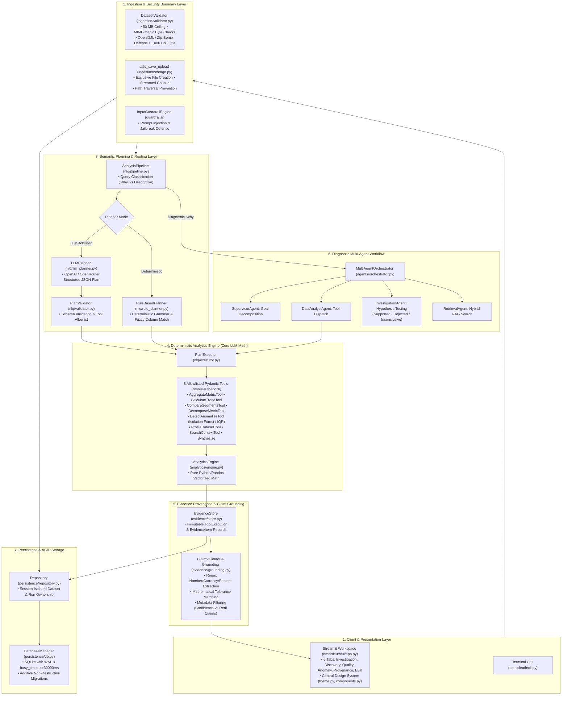

# OmniSleuth — System Architecture & Component Design

**OmniSleuth** is an evidence-grounded data investigation platform that analyzes structured business datasets (sales, transactions, orders, inventory) without mathematical hallucination or unconstrained code execution.

This document describes the architectural foundations, module interactions, security boundaries, and execution workflows implemented in the codebase.

---

## 1. System Architecture Overview

---

## 2. Component Responsibility: Planning vs. Computation

A core architectural principle of OmniSleuth is the **strict separation of planning from computation**:

| Operation | Responsible Component | Implementation | LLM Role |
|---|---|---|---|
| **Query Intent & Routing** | `AnalysisPipeline` (`omnisleuth/nlq/pipeline.py`) | Categorizes query into descriptive aggregates, trend questions, or diagnostic "why" investigations. | Optional planner input; rule-based classification fallback. |
| **Execution Planning** | `LLMPlanner` or `RuleBasedPlanner` | Generates a structured JSON plan specifying tool names, column targets, operations, and parameters. | **Planner only**. The LLM produces JSON instructions; it executes no code. |
| **Plan Validation** | `PlanValidator` (`omnisleuth/nlq/validator.py`) | Validates that proposed tools are on the allowlist and target columns exist in the active dataset schema. | **None**. Deterministic schema check. |
| **Mathematical Computation** | `AnalyticsEngine` & allowlisted tools (`omnisleuth/analytics/`, `tools/`) | Executes pandas aggregations, percentage changes, segment grouping, and Order $\times$ AOV decomposition. | **Zero**. Pure Python/pandas code. No LLM arithmetic. |
| **Anomaly Detection** | `IQRAnomalyDetector` & `IsolationForestDetector` (`omnisleuth/ml/detectors.py`) | Computes interquartile ranges and scikit-learn tree isolation scores. | **Zero**. Pure scikit-learn / numpy computation. |
| **Evidence Minting** | `EvidenceStore` (`omnisleuth/evidence/store.py`) | Creates immutable `EvidenceItem` records with unique hashes, parameter provenance, and raw data outputs. | **None**. Deterministic state tracking. |
| **Claim Grounding** | `ClaimValidator` & `grounding.py` (`omnisleuth/evidence/`) | Extracts numbers, percentages, and currencies from generated text and verifies them against `EvidenceItem` records. | **None**. Programmatic regex and numerical tolerance verification. |
| **Text Narration (Optional)** | `LLMGateway` (`omnisleuth/llm/gateway.py`) | Rewrites grounded facts into user-friendly narrative summaries. | **Text synthesis only**. Numbers are pre-computed; unverified claims are rejected. |

---

## 3. The Interactive Presentation Layer (Six Workspace Tabs)

The UI is implemented in Streamlit ([`omnisleuth/ui/app.py`](file:///d:/OmniSleuth/omnisleuth/ui/app.py)) with centralized design tokens ([`omnisleuth/ui/theme.py`](file:///d:/OmniSleuth/omnisleuth/ui/theme.py)) and reusable components ([`omnisleuth/ui/components.py`](file:///d:/OmniSleuth/omnisleuth/ui/components.py)):

1. **Investigation Tab (`tabs[0]`):**
   - Single natural language question input box with pre-built example buttons.
   - Explicit planner toggle: *Deterministic (rule-based)* vs *LLM-assisted (validated plan)*.
   - Visual execution plan stepper showing tool execution progress.
   - Answer Hero Card displaying the grounded conclusion.
   - Diagnostic hypothesis evaluation cards (`Supported`, `Rejected`, `Inconclusive`).
   - Programmatic claim validation table showing verification badges and matched tolerances.
   - Allowlisted Plotly visual chart rendered from computed table rows.

2. **Discovery Tab (`tabs[1]`):**
   - Multi-dimensional autonomous scanner (`DatasetDiscoveryScanner`).
   - Pre-scan empty state with capability pills.
   - Significance indicator summary bar (High: red indicator, Medium: amber indicator, Low: slate indicator).
   - Ranked discovery finding cards displaying categories, empirical summaries, recommended questions in styled callouts, hierarchical tree path blocks, and collapsible raw evidence JSON payloads.

3. **Data Quality Tab (`tabs[2]`):**
   - Dataset profiler (`DatasetProfiler`) generating completeness and validity statistics.
   - 4 Executive KPI cards: Completeness %, Duplicate Rows, Quality Alerts, Columns Profiled.
   - Severity-grouped alert callouts (`[CRITICAL]`, `[WARNING]`, `[INFO]`) with clear contextual explanations.
   - Structured profile dataframes for Numeric columns (mean, std, min, 25%, 50%, 75%, max, nulls) and Categorical columns (distinct count, top value, frequency, nulls).

4. **Anomaly Explorer Tab (`tabs[3]`):**
   - Interactive feature and detection-method controls (`Isolation Forest` vs `IQR`).
   - 3 Anomaly summary KPI cards: Total Anomalies, Anomaly Rate %, Contamination/Method.
   - Statistical Non-Causality Banner: Explicitly warns analysts that statistical deviation does not establish causal defect.
   - Standardized Plotly Box Plot chart rendered via `get_plotly_layout_template()`.
   - Flagged anomalous records table with dimension attributes.

5. **Evidence & Provenance Tab (`tabs[4]`):**
   - 5-stage Cryptographic Provenance Chain:
     `Dataset Ingestion` ➔ `Schema Validation` ➔ `Analytics Tool Execution` ➔ `Claim Extraction` ➔ `Grounded Answer`
   - Session & Query Audit Log tracking all executed queries, tool calls, and timestamps.
   - Active Evidence Store table displaying minted evidence items, source tool executions, confidence ratings, and extracted claims.

6. **Evaluation Tab (`tabs[5]`):**
   - 8-Metric Benchmark Scorecard: 4 primary metrics (Numerical Correctness %, Tool Selection Accuracy %, Grounded Claim Coverage %, P95 Latency) and 4 secondary metrics (Precision, Hallucination Rate, Cross-Session Leakage, Token Usage).
   - 3-System Architectural Comparison: Direct Tool Baseline vs Fixed Pipeline Baseline vs OmniSleuth Agentic Architecture.
   - Zero fabricated baseline numbers; renders empirical benchmark measurements across 40 evaluation questions.

---

## 4. Ingestion, Validation & Safe Storage

Located in [`omnisleuth/ingestion/`](file:///d:/OmniSleuth/omnisleuth/ingestion/):

- **Format Verification:** Allowlisted extensions: `.csv`, `.parquet`, `.xlsx`.
- **DoS Ceilings:** 50 MB maximum file size (`max_upload_size_bytes`) and 1,000 maximum column count (`max_columns`).
- **Binary Signature Inspection:** Inspects leading magic bytes to reject disguised executables (`MZ`, `ELF`), images (`PNG`, `GIF`, `JPEG`), PDFs (`%PDF`), and compressed archives (`GZIP`, `XZ`, `BZIP2`) uploaded with `.csv` extensions.
- **Excel OpenXML Protection:** Inspects ZIP container structure (`[Content_Types].xml`, `xl/workbook.xml`), runs `testzip()` to catch corrupted members, and enforces compression ratio limits to defeat decompression bombs.
- **Atomic Storage:** `safe_save_upload()` writes files in 64 KB chunks using `os.O_CREAT | os.O_EXCL`, verifies parent directory containment to block directory traversal attacks (`../`), and cleans up orphaned files on failure.

---

## 5. Persistence, Session Isolation & Concurrency

Located in [`omnisleuth/persistence/`](file:///d:/OmniSleuth/omnisleuth/persistence/):

- **Database Engine:** SQLite accessed via standard library `sqlite3`.
- **Journal Mode (WAL):** Configured via `PRAGMA journal_mode = WAL;` during database initialization in `DatabaseManager.initialize_schema()`. SQLite persists WAL mode in the database file header so all future connections benefit from write-ahead logging without per-query pragma overhead.
- **Concurrency & Locking:** Connection configured with `PRAGMA busy_timeout = 30000;` (30 seconds) and `PRAGMA foreign_keys = ON;`. In WAL mode, readers do not block writers and writers do not block readers.
- **WAL Sidecar Files:** SQLite creates `<dbname>-wal` (write-ahead log) and `<dbname>-shm` (shared-memory index) sidecars alongside the database. Persistent volume mounts (`/app/data/`) must encompass these sidecar files.
- **Single-Host Limitation:** SQLite WAL relies on shared memory and local filesystem advisory locks; it cannot be shared across multiple distributed application replicas or network filesystems without corruption risk.
- **Schema Evolution:** Non-destructive additive migrations (`DatabaseManager._apply_additive_migrations`) automatically add required columns (such as `session_id`, `result_table_json`, `chart_spec_json`) if absent, without dropping tables or losing historical data.
- **Session Isolation:** All datasets and investigations are tagged with an opaque pseudonymous `session_id`. `Repository` methods filter queries by `session_id`, preventing cross-session data leakage or unauthorized dataset deletion.

---

## 6. Evaluation Methodology

Located in [`omnisleuth/evaluation/evaluator.py`](file:///d:/OmniSleuth/omnisleuth/evaluation/evaluator.py):

- **Standard Benchmark Set:** 40 curated business questions (`BENCHMARK_QUESTIONS`) covering aggregations, multi-period trends, segment comparisons, margin calculations, and anomaly investigations on synthetic retail sales data with planted anomalies.
- **Measured Metrics:**
  - **Numerical Correctness (%):** Mathematical accuracy of computed answers against deterministic ground truth.
  - **Tool Selection Accuracy (%):** Whether the planner selected the allowlisted tool best suited for the query structure.
  - **Grounded Claim Coverage (%):** Percentage of factual claims backed by valid evidence items.
  - **Unsupported Claim Rate (%):** Percentage of extracted claims that fail tolerance matching.
  - **Latency (ms):** End-to-end plan generation and execution time (p50 and p95).
- **Architectural Comparisons:** Evaluates OmniSleuth's dynamic multi-agent planning against a Direct Tool Invocation baseline and a Fixed Non-Agentic Pipeline baseline.
