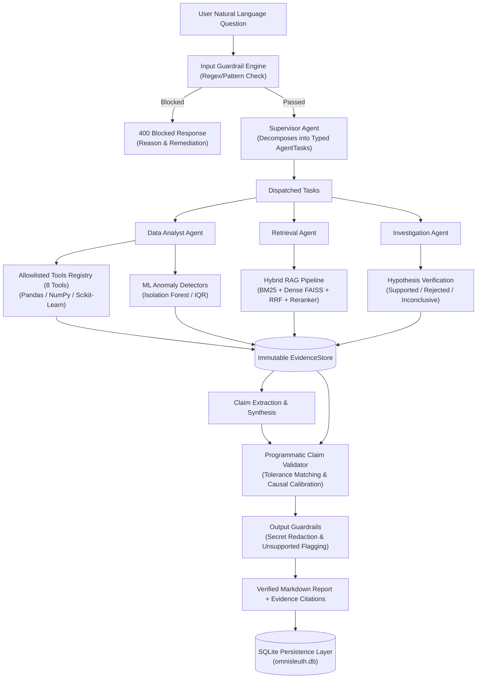

# OmniSleuth — System Architecture & Component Design

## 1. Module Overview & Directory Map

```text
omnisleuth/
├── core/             # Configuration, logging, base exceptions
│   ├── config.py         -> Settings (pydantic-settings)
│   ├── logging.py        -> configure_logging, get_logger
│   └── exceptions.py     -> OmniSleuthError hierarchy
├── ingestion/        # Tabular data ingestion and integrity verification
│   ├── csv_loader.py     -> CSVLoader (UTF-8/Latin-1, delimiter detection)
│   ├── schema_detector.py-> SchemaDetector (type inference, column schemas)
│   └── models.py         -> DatasetMetadata, ColumnSchema
├── profiling/        # Statistical profiling & data quality scorecards
│   ├── profiler.py       -> DatasetProfiler (completeness, cardinality, duplicates)
│   └── models.py         -> ProfilingReport, QualityWarning, ColumnProfile
├── analytics/        # Deterministic computation engine
│   ├── engine.py         -> AnalyticsEngine (aggregates, trends, segments, decomposition)
│   └── models.py         -> TrendResult, SegmentComparisonResult, DecompositionResult
├── ml/               # Machine learning anomaly detectors
│   ├── detectors.py      -> IQRAnomalyDetector, IsolationForestDetector
│   └── models.py         -> AnomalyDetectionResult
├── tools/            # 8 strictly allowlisted Pydantic analytical tools
│   ├── base.py           -> BaseTool, BaseToolInput, BaseToolOutput
│   ├── definitions.py    -> ProfileDatasetTool, AggregateMetricTool, CalculateTrendTool, ...
│   └── __init__.py       -> ToolRegistry, get_default_tool_registry
├── evidence/         # Immutable provenance and programmatic claim validation
│   ├── store.py          -> EvidenceStore (ToolExecution, EvidenceItem tracking)
│   ├── validator.py      -> ClaimValidator (tolerance matching, causal calibration)
│   └── models.py         -> EvidenceItem, Claim, Hypothesis, ToolExecution, InvestigationNode
├── rag/              # Hybrid retrieval-augmented generation
│   ├── document_store.py -> DocumentStore (hybrid sparse + dense retrieval)
│   ├── bm25.py           -> BM25Index (tokenized sparse search)
│   ├── dense_embedder.py -> DenseEmbedder (SentenceTransformers / deterministic fallback)
│   ├── faiss_index.py    -> FAISSIndex (FAISS / NumPy cosine similarity fallback)
│   ├── fusion.py         -> Reciprocal Rank Fusion (RRF)
│   ├── reranker.py       -> SemanticReranker (CrossEncoder / deterministic fallback)
│   └── seed_docs.py      -> Seed operational reports, KPI definitions, data dictionaries
├── agents/           # Specialized multi-agent roles and orchestration
│   ├── supervisor.py     -> SupervisorAgent (structured JSON planning)
│   ├── analyst.py        -> DataAnalystAgent (tool dispatching and evidence minting)
│   ├── retriever.py      -> RetrievalAgent (contextual RAG search)
│   ├── investigator.py   -> InvestigationAgent (hypothesis verification)
│   ├── orchestrator.py   -> MultiAgentOrchestrator (end-to-end lifecycle coordinator)
│   └── models.py         -> AgentTask, InvestigationPlan, AgentRole
├── workflow/         # LangGraph state machine workflow
│   ├── state.py          -> InvestigationState (TypedDict shared state)
│   ├── nodes.py          -> Step functions for graph execution
│   └── graph.py          -> build_investigation_graph, CompiledStateGraph fallback
├── discovery/        # Autonomous multi-dimensional auto-scanner
│   ├── scanner.py        -> DatasetDiscoveryScanner (trend, anomaly, segment shift scans)
│   └── models.py         -> DiscoveryFinding, FindingCategory
├── guardrails/       # Multi-layer safety and sanitization
│   ├── input_guardrails.py  -> InputGuardrailEngine (injection, jailbreak, code, off-topic)
│   ├── output_guardrails.py -> OutputGuardrailEngine (unsupported claims, secrets, causality)
│   └── patterns.py          -> Regex patterns for injection and secret redaction
├── llm/              # Centralized LLM Gateway
│   ├── gateway.py        -> LLMGateway (coordinator)
│   ├── providers.py      -> OpenAIProvider, AzureOpenAIProvider, DeterministicFallbackProvider
│   ├── retry.py          -> execute_with_retry, is_transient_error
│   ├── cache.py          -> SemanticCache (dataset-version isolated)
│   ├── tracing.py        -> LLMTracer, generate_request_id
│   └── usage.py          -> calculate_usage_and_cost
├── persistence/      # SQLite ACID persistence
│   ├── db.py             -> DatabaseManager (schema migrations)
│   ├── repository.py     -> Repository (save/load datasets, runs, evidence)
│   └── serializer.py     -> safe_json_dumps, safe_json_loads
├── ui/               # Interactive frontend
│   └── app.py            -> Streamlit 5-tab application
└── cli.py            # Terminal command-line interface
```

---

## 2. Important Core Interfaces

### 2.1 Allowlisted Tool Contract
All analytical tools implement [BaseTool](file:///d:/OmniSleuth/omnisleuth/tools/base.py):
```python
class BaseTool(ABC):
    name: str
    description: str
    input_schema: Type[BaseModel]

    @abstractmethod
    def execute(self, df: pd.DataFrame, parameters: Dict[str, Any]) -> BaseToolOutput:
        """Executes pure deterministic math or ML on DataFrame; returns typed BaseToolOutput."""
```

### 2.2 Evidence Minting Contract
Execution results are recorded into [EvidenceStore](file:///d:/OmniSleuth/omnisleuth/evidence/store.py):
```python
class EvidenceStore:
    def record_tool_execution(
        self, tool_name: str, parameters: Dict[str, Any], output: BaseToolOutput
    ) -> ToolExecution: ...

    def add_evidence(self, item: EvidenceItem) -> None: ...
    def list_evidence(self, evidence_type: Optional[EvidenceType] = None) -> List[EvidenceItem]: ...
```

### 2.3 Programmatic Claim Validator
Text statements are validated in [ClaimValidator](file:///d:/OmniSleuth/omnisleuth/evidence/validator.py):
```python
class ClaimValidator:
    def __init__(self, numerical_tolerance_pct: float = 1.0): ...
    def extract_numbers_from_text(self, text: str) -> List[float]: ...
    def check_unsupported_causality(self, text: str) -> Tuple[bool, List[str], str]: ...
    def validate_claim(self, claim: Claim, evidence_store: EvidenceStore) -> ValidationResult: ...
```

### 2.4 LLM Gateway Contract
All generative requests pass through [LLMGateway](file:///d:/OmniSleuth/omnisleuth/llm/gateway.py):
```python
class LLMGateway:
    def generate(self, request: LLMRequest) -> LLMResponse:
        """Coordinated pipeline:
        1. Unique request ID (llm_req_*)
        2. Semantic cache check (isolated by dataset_version)
        3. Provider call with bounded exponential backoff
        4. Deterministic fallback on missing keys or transient failure
        5. Token and cost audit logging
        """
```

---

## 3. End-to-End Investigation Data Flow

OmniSleuth operates two execution engines sharing identical tools and evidence contracts:
1. **MultiAgentOrchestrator** (Primary engine used by Streamlit UI and CLI): Direct object-oriented agent coordination.
2. **LangGraph StateGraph** (Alternative compiled workflow in `omnisleuth/workflow/graph.py`): Explicit state-graph machine with conditional routing.



---

## 4. Key Subsystem Implementation Details

### 4.1 Hybrid RAG Engine
- **Sparse**: [BM25Index](file:///d:/OmniSleuth/omnisleuth/rag/bm25.py) tokenizes queries and documents, scoring exact terminology and KPI names.
- **Dense**: [DenseEmbedder](file:///d:/OmniSleuth/omnisleuth/rag/dense_embedder.py) generates vector embeddings via `sentence-transformers/all-MiniLM-L6-v2`. If uninstalled, falls back to deterministic term-hash vector embeddings.
- **Vector Search**: [FAISSIndex](file:///d:/OmniSleuth/omnisleuth/rag/faiss_index.py) utilizes `IndexFlatIP`. If `faiss` is uninstalled, falls back to pure NumPy cosine similarity matrix operations.
- **Fusion**: [Reciprocal Rank Fusion (RRF)](file:///d:/OmniSleuth/omnisleuth/rag/fusion.py) combines sparse and dense rankings: $RRF(d) = \sum_{m} \frac{1}{60 + \text{rank}_m(d)}$.
- **Reranker**: [SemanticReranker](file:///d:/OmniSleuth/omnisleuth/rag/reranker.py) scores top-$K$ pairs via `cross-encoder/ms-marco-TinyBERT-L-2-v2` with deterministic lexical fallback.

### 4.2 Multi-Layer Guardrails
- **Input Filtering**:
  - Checks for prompt injection keywords ("ignore previous", "disregard instructions").
  - Intercepts jailbreaks ("DAN mode", "developer mode").
  - Rejects arbitrary code requests (`exec()`, `eval()`, `os.system()`).
  - Flags out-of-scope queries (general trivia, creative writing).
- **Output Filtering**:
  - Detects numbers in generated text unbacked by raw evidence items.
  - Automatically rewrites definite causal assertions ("caused by" $\rightarrow$ "associated with").
  - Redacts potential secrets and API keys via high-entropy and prefix regex scanning.

### 4.3 Database Schema & Persistence
SQLite database schema initialized in [DatabaseManager](file:///d:/OmniSleuth/omnisleuth/persistence/db.py):
- `datasets`: Metadata, row count, column count, SHA-256 fingerprint.
- `dataset_versions`: Schema JSON per version hash.
- `investigations`: Investigation ID, question, plan JSON, status, final answer.
- `tool_executions`: Tool name, parameters, execution time, result JSON, error.
- `evidence_items`: Immutable evidence facts, source IDs, confidence, content JSON.
- `hypotheses`: Statement, resolution status, confidence, evaluation summary.
- `claims`: Natural language statements, verification status, notes.
