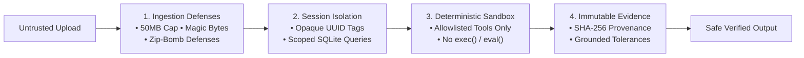
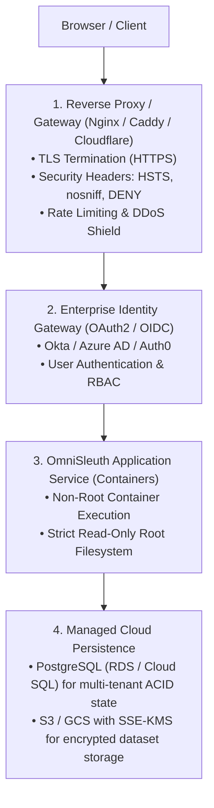

# OmniSleuth — Security Architecture, Controls & Deployment Boundaries

This document defines the security architecture, implemented defense mechanisms, and operational boundaries of the **OmniSleuth** platform.

---

## 1. Verified Implemented Security Controls

These controls are actively enforced in the codebase and covered by automated tests (`tests/test_security_audit.py`, `tests/test_upload_validation.py`, `tests/test_guardrails.py`):



### 1.1 Ingestion & File Upload Defenses
- **Strict Size Ceilings:** Global 50 MB upload limit enforced before streaming to disk.
- **MIME & Magic Byte Inspection:** Inspects leading binary bytes to block disguised Windows PE (`MZ`), Linux ELF (`\x7fELF`), PNG, JPEG, PDF, and GZIP/XZ archives disguised as `.csv`.
- **Excel OpenXML Structure Validation:** Verifies that `.xlsx` files contain valid OpenXML structures (`[Content_Types].xml`, `xl/workbook.xml`) and executes `zipfile.testzip()` to catch corrupted members.
- **Decompression Bomb (ZIP-Bomb) Defense:** Enforces strict uncompressed-to-compressed size ratio checks and absolute uncompressed size limits during archive inspection.
- **Column-Count DoS Protection:** Rejects datasets with more than 1,000 columns to prevent memory exhaustion during tabular pivoting and dataframe profiling.
- **Atomic File Streaming & Traversal Protection:** Uploads are streamed in 64 KB chunks using `os.O_CREAT | os.O_EXCL` into `data/uploads/`. Path resolution enforces containment within the upload directory, rejecting path traversal attempts (`../`).

### 1.2 Deterministic Execution (RCE Elimination)
- **Zero Arbitrary Code Execution:** The LLM is never permitted to write or execute arbitrary Python code. Neither `eval()` nor `exec()` exists in the analytics pipeline.
- **Allowlisted Pydantic Tooling:** All calculations are executed by 8 allowlisted tools with typed Pydantic schemas. Tool parameters are validated against dataset schemas before execution.

### 1.3 Evidence Provenance & Programmatic Grounding
- **Immutable Tool Records:** Every tool execution is recorded in an `EvidenceStore` with unique UUIDs, timestamp, parameters, and raw output data.
- **Numerical Claim Extraction & Tolerance Matching:** The claim grounding engine extracts all numbers, currency values, and percentages from natural language answers using regular expressions. Each extracted value must mathematically match a stored `EvidenceItem` within defined relative/absolute tolerance thresholds.
- **Metadata Filtering:** System metadata (e.g. "80% confidence") is filtered from analytical claims, while genuine financial figures (e.g. "100% of revenue in Q4") are strictly validated against evidence.
- **Unsupported Claim Rejection:** If an answer makes factual claims that cannot be grounded in empirical tool evidence, the claim is flagged as unsupported or rejected.

### 1.4 SQLite Concurrency & Additive Migrations
- **Busy Timeout:** Database connections set `PRAGMA busy_timeout = 30000;` (30 seconds) to prevent concurrency locking errors during simultaneous read/write operations.
- **Foreign Key Constraints:** `PRAGMA foreign_keys = ON;` enforces relational integrity between datasets, investigations, tool executions, and claims.
- **Non-Destructive Additive Migrations:** Database schema updates only add missing columns (`ALTER TABLE ... ADD COLUMN`) and indices. No user data or prior audit history is dropped or overwritten.

---

## 2. Current Architectural Boundaries & Limitations

### 2.1 Pseudonymous Browser Session vs. True Authentication
- **Current State:** Sessions are identified using an opaque UUID generated in Streamlit session state (`sess_<uuid>`).
- **Limitation:** This is a **pseudonymous browser session identifier**, not a cryptographic authentication token. It prevents accidental cross-tab data contamination within a single instance, but provides no user identity verification, password hashing, or role-based access control (RBAC).

### 2.2 Local SQLite & Single-Instance Concurrency
- **Current State:** Storage uses a local SQLite database (`data/omnisleuth.db`) and local filesystem uploads (`data/uploads/`).
- **Limitation:** SQLite is single-host storage. It cannot be safely mounted read-write across multiple concurrent container replicas or distributed nodes without risking database corruption.

### 2.3 Absence of TLS / Security Headers in Streamlit
- **Current State:** Streamlit's internal Uvicorn server serves raw HTTP on port 8501.
- **Limitation:** Streamlit does not terminate TLS (HTTPS) and does not natively emit HSTS, `X-Content-Type-Options: nosniff`, `X-Frame-Options: DENY`, or CSP headers.

---

## 3. Production Deployment Requirements (Future Scope)

Before OmniSleuth can be deployed as an internet-facing, multi-tenant enterprise service, the following infrastructure layers must be added:



### 3.1 Reverse Proxy Layer (Nginx / Caddy / Cloudflare)
- **TLS Termination:** Enforce HTTPS with TLS 1.3 and automatic certificate renewal.
- **HTTP Security Headers:** Inject `Strict-Transport-Security: max-age=31536000; includeSubDomains`, `X-Content-Type-Options: nosniff`, `X-Frame-Options: SAMEORIGIN`, and `Referrer-Policy: strict-origin-when-cross-origin`.
- **WebSocket Upgrade Proxying:** Streamlit requires specific proxy configuration to pass `/_stcore/stream` WebSockets:
  ```nginx
  proxy_http_version 1.1;
  proxy_set_header Upgrade $http_upgrade;
  proxy_set_header Connection "upgrade";
  ```

### 3.2 Enterprise Authentication (OAuth2 / OIDC)
- Replace pseudonymous session IDs with verified JSON Web Tokens (JWT) issued by an enterprise identity provider (Okta, Azure AD, Cognito, or Keycloak).
- Isolate tenant datasets by cryptographically verified Organization ID and User ID.

### 3.3 Managed Cloud Persistence
- **Database:** Migrate from local SQLite to managed PostgreSQL (e.g. Amazon RDS, Google Cloud SQL) for concurrent multi-pod horizontal scaling and point-in-time recovery.
- **Object Storage:** Migrate from local filesystem `data/uploads/` to encrypted cloud object storage (Amazon S3 or Google Cloud Storage) with server-side encryption (SSE-KMS) and bucket retention policies.

---

## 4. Single-Instance Demo vs. Multi-Tenant Production Disclaimer

> [!CAUTION]
> **Important Distinction:**
> OmniSleuth in its current repository state is a **hardened, single-instance data investigation workspace** designed for local analysts and secure single-node container deployment.
> It is **NOT** a public multi-tenant SaaS application. Do not expose the raw Streamlit container port (8501) directly to the public internet without an authenticating reverse proxy, TLS encryption, and rate limiting.
